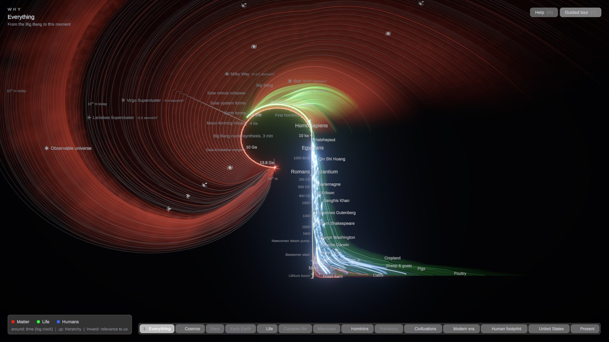
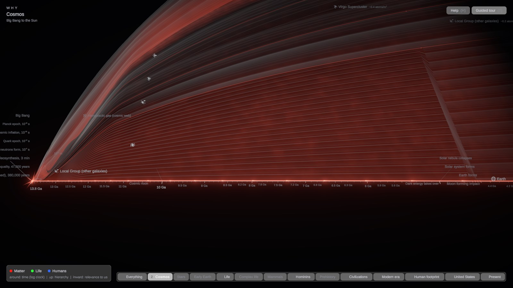
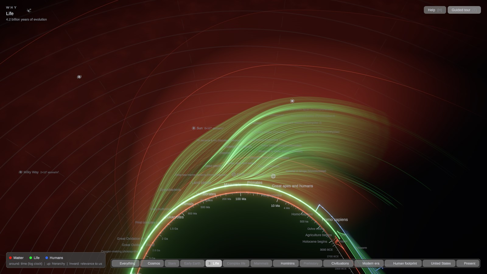
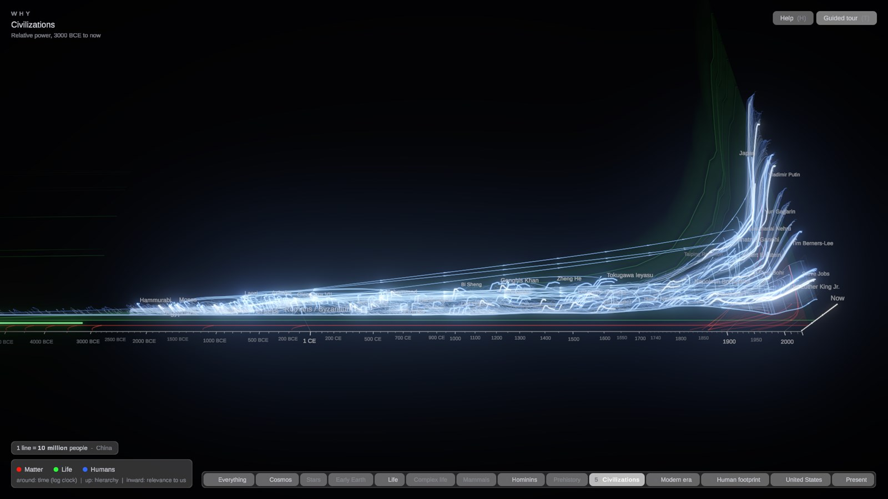
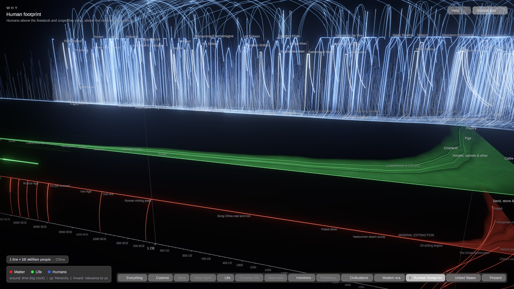
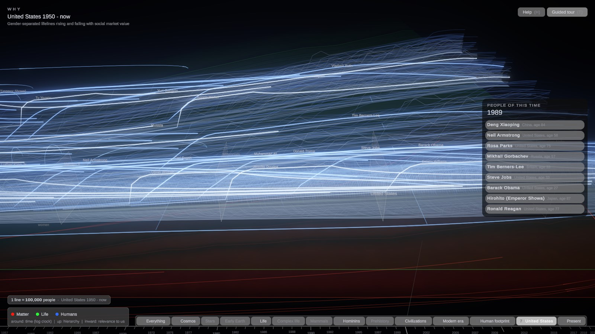
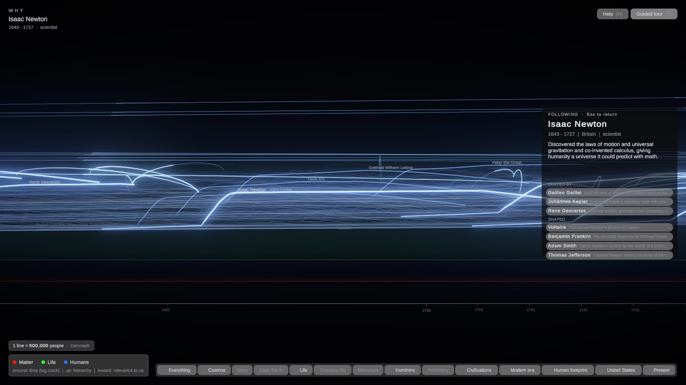
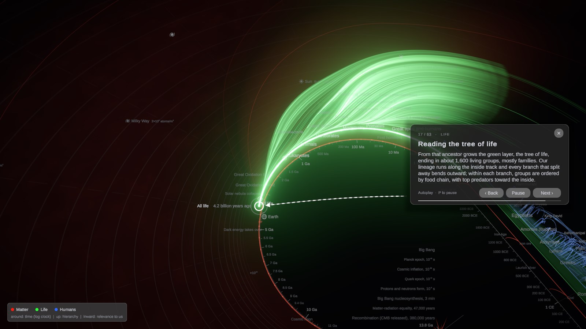
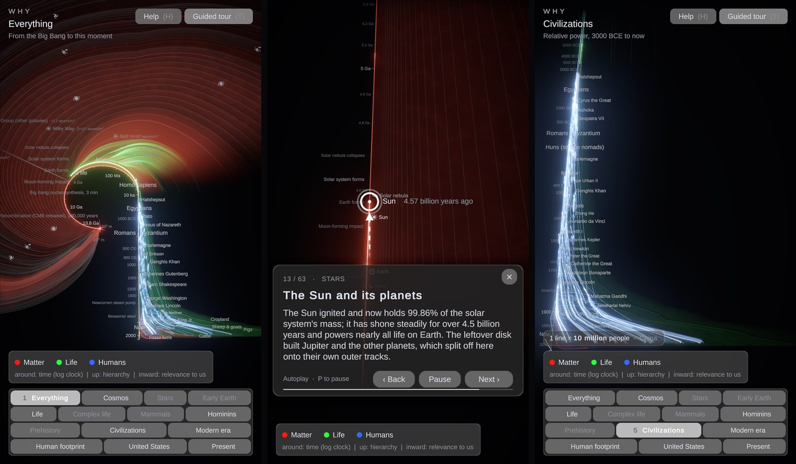

# why

A causality graph that starts at the Big Bang and ends at the present moment. It is built to show,
cleanly and at every scale, how each thing that happened made the next one possible.

## Reading the graph

| | |
| --- | --- |
| **Path** | Time runs clockwise. From the Big Bang at 6 o'clock the path circles a super-logarithmic clock of deep time (`Ft(t) = t^(t^(-1.4 - 2.39t))`): stars and the Sun, Earth, life near 10 o'clock. At 3 o'clock, 5,000 years ago, it stops being a clock: human history leaves the circle on a straight branch with near-linear time, ending at the present moment. |
| **Color** | Used for one thing only - the three levels of the universe: **red** = all matter, **green** = all life, **blue** = humans. Everything else is neutral grey. |
| **Height** | The same hierarchy: matter at the bottom, life above it, humans on top. Human lifelines rise and fall with modeled social market value. |
| **Radius** | Relevance to us. The inner track is our own lineage (universe, Milky Way, Sun, Earth, first cells ... great apes, civilizations); everything that split off along the way drifts outward and fades. |
| **Glow** | Attention: our lineage, famous figures, and whatever the guide is pointing at. |

**Red - matter.** Our home at every scale, nested from the inside out: Earth, the Sun, the Milky Way, the
Local Group, the Virgo Supercluster and Laniakea, inside the observable universe. The red layer follows
the real expansion of space (a Lambda-CDM scale factor), so it billows out across the early clock, and
every nested body grows with it as a contour that splits off smoothly, never in steps. Each region is
shaded by its real density, so the gaps between the contours read as orders of magnitude - from 3x10^30
atoms/m^3 in Earth to 2x10^5 between the stars and ~0.3 between the galaxies - and every strand carries
an icon (sun, spiral galaxy, galaxy group, supercluster, cosmic web ...). Beneath it a faint grid draws
the physical scale of that map: shells at every round distance from our lineage (10, 100, 1000 metres ...
out to the edge of the observable universe), which enter at the envelope as the universe grows past them,
and rays that follow the matter a round distance from us today back toward the Big Bang, fanning out with
the expansion of space. Between neighbouring lines the distance grows tenfold, finer lines appear as you
zoom, and the probe (G) reads real numbers anywhere: metres from us, metres per unit of the graph. Matter
dissolves before the human branch.

**Green - life.** The TimeTree of Life (1610 families) drawn as an expanding set of roots. Branches are
ordered by food chain with the top predator on the inside track, so the innermost root is the one that
leads to us: our direct ancestors glow, everything else stays dim, and the red layer recedes in the
life views. Life dissolves before the human branch; only our lineage rises into it (Homo sapiens,
300,000 years ago).

**Calories flow upward.** The food-chain order is also drawn as what it means: every level lives on the
calories of the level beneath it. In the life views, at three moments - the Devonian seas, the age of
dinosaurs and the Miocene grasslands - green arcs carry energy from producers to herbivores, predators and
top predators between their actual branches (green algae, crustaceans, cephalopods, sharks; cycads, leaf
beetles, amphibians, crocodilians; grasses, moths, swallows, falcons). Only roughly 10% of the energy passes
each step, so every arc is about ten times thinner and dimmer than the one before, and its pulses run from
prey to predator, inward toward our lineage.

**Beneath the humans - domination.** Directly under the civilizations lies the life people control -
livestock and crops, in green, on the same mass scale as humans (livestock now outweighs us) - and
beneath that the matter people extract - fuels, ores and minerals, in red. Every domestication is marked
where the species enters the farm layer; each material rises out of Earth's matter band.

**Blue - humans.** Civilization streams from the *Histomap* (Sparks 1931) whose widths are relative
power, continued to today with GDP shares. Inside each stream a gender-separated population curve holds
individual lifelines (women inside, men outside) that rise and fall with social market value; each line
stands for N people (shown on screen). The whole human layer starts as a thread and explodes outward with population. Famous figures glow,
threads show who influenced whom, and the people panel (F) lists who was alive at any moment. The United States 1950 - now is simulated
in detail from UN age pyramids with marriage, divorce, births and partner counts (the former `smv`
project); children's lines start from their parents.

## In pictures

| | |
| --- | --- |
|  |  |
| **The cosmic fan.** Our home bodies expand with the universe, each strand marked with an icon and its density; beneath them the scale grid, one line per order of magnitude of distance from us. | **Life.** The roots of the tree of life, our direct ancestors glowing on the inside track. |
|  |  |
| **Civilizations.** Streams sized by relative power, starting as a thread and exploding with population; famous figures glow. | **Human footprint.** Humans on top, the livestock and crops they raise beneath, the minerals they mine beneath that. |
|  |  |
| **United States 1950 - now.** Gender-separated lifelines rising and falling with social market value, with the people of the moment. | **Following a figure.** Isaac Newton's life among his contemporaries, with who shaped him and whom he shaped. |
|  |  |
| **Guided tour.** 63 narrated stops with attention arrows, from the Big Bang to this moment. | **Vertical mode.** Every view, the tour and the HUD re-laid out for 9:16 phone videos. |

## Controls

| Input | Action |
| --- | --- |
| Right drag | orbit |
| Middle drag / Shift + left drag | pan |
| Scroll | zoom toward the cursor |
| W A S D / Q E | move |
| 1 - 9 | views: everything, cosmos, life, hominins, civilizations, modern era, US population, the present, human footprint |
| U | unroll the timeline around what you are looking at (again to roll back up) |
| [ / ] | widen / narrow the unrolled time window |
| L | cycle log / mixed / linear time in the unrolled window |
| T | guided tour (director mode): Space / Right next, Left back, P pause, M mute the narration, Esc exit; it ends by continuing into the economy |
| Tab | switch between the universe and the economy |
| F | people of this time: famous figures alive at the moment you are looking at; click one to follow their life |
| G | scale probe: point at the red layer to read the distance from us in metres, and how many metres (and years) one unit of the graph stands for there |
| V | vertical mode: a 9:16 layout for recording phone videos (again to go back) |
| H | help |
| Hover / click a label | details / focus and highlight it |

## Narration

The whole model has a spoken, guided walkthrough in John's own voice (an ElevenLabs clone, "JohnV4"), top to
bottom: it opens with why the graph exists - understand cause and effect and you can build a working model of the
universe from the Big Bang to this moment - walks the three levels across 64 stops, and at its end continues straight
into the economy scene for 14 more (the wave, its foundation and layers, golden circles, rivers of desire and fear,
one person's mind, tit for tat, the ladder). About 34 minutes in all.

* Scripts (tracked): `Assets/Resources/Data/Walkthrough/` - `tour.json` and `economy_tour.json` hold each stop's view,
  arrow target and on-screen text; `tour_narration.json` and `economy_narration.json` hold what is spoken. Each spoken
  stop was checked against its on-screen text with Jev (contradiction, unsupported claims, faithfulness).
* Voice: `python3 Tools/synthesize-narration-elevenlabs.py` writes `Assets/Resources/Audio/Tour/<id>.ogg` and
  `Audio/EconomyTour/<id>.ogg` (key from `$ELEVENLABS_API_KEY` or `~/Desktop/eleven-key.txt`, never printed; only
  stops whose text changed are re-voiced; ffmpeg converts to Ogg). The clips are generated, so they stay out of Git.
* A local `Data/tour.json` still overrides the walkthrough while drafting; a stop without a clip reads its on-screen
  text at the usual pace. The older OpenAI/Cartesia scripts (`Tools/generate-narration.ps1`,
  `Tools/synthesize-narration.ps1`) remain for reference.

## Meta Quest

Both scenes run on Meta Quest (OpenXR, Android, Vulkan, single-pass instanced). Desktop builds are unaffected: XR
starts only on Android.

* Build: `Tools/build-quest.sh` (add `--copy` while the Editor has the project open, `--install` to sideload over USB
  with developer mode on), or **Why > Quest > Build APK** in the Editor. Output: `Builds/Quest/why.apk`
  (`io.primitive.why`); on the headset it is under Library > Unknown Sources. **Why > Quest > Configure XR** (also run
  by every build) sets OpenXR with the Meta Quest feature and Touch / Touch Plus / Touch Pro controllers.
* In the headset every view is a diorama: the view's subject sits at arm's length and the world is scaled to it, so
  the Big Bang, a clade or one lifeline can each be walked around - and the world can be grabbed and resized at will.

| Controller | Action |
| --- | --- |
| Right trigger | point and select (labels, people, companies, panels) |
| Grip + pull | drag the world; both grips pulled apart / together: grow / shrink it around your hands |
| Left stick | fly over the graph, where you look |
| Right stick | up / down zoom, left / right turn the world 30 degrees |
| A / B / Y | guided tour: next (starts it) / back / leave |
| X | hand menu: the views, the tour, the other scene, recenter |
| Left stick click | recenter |

Panels float on a HUD plane that follows your gaze; the tour's target is marked by a beacon in the world instead of the
screen arrow. Line widths are still in pixels per eye, and frame rate on device has not been profiled yet.

## Vertical mode

For tutorial videos watched on a phone, the whole experience re-lays itself out whenever the window is
taller than it is wide: the HUD and tour text grow to phone size, the tour narration docks as a bottom
(or top) sheet clear of its arrow, and unrolled views turn so time runs down the screen. In the Editor,
press V in Play mode or use **Why > Game View > Portrait 1080x1920** (and **Landscape 1920x1080** to go
back); record with Unity Recorder or any screen recorder. In a built player, V opens a 9:16 window.

## The economy scene

Open `Assets/Scenes/Economy.unity` and press Play. The economy is a wave moving forward through time: the road of
United States lives (1946 to now) and the economy share one time axis, and at its end the population's cross-section
opens into a hillside of industries. Each rib behind the crest is one year's economy, widening as real output grows;
raw materials, manufacturing and infrastructure, services and tech stand on one another on a government bedrock, each
industry a ridge as wide as its share of value added. The crest is the shown year. 75 companies live on the ridges like
people on the road: born, rising and falling with their (approximate) market value, failing, bought or reaching the
crest, colored by how Jev judged each one sells (need, manufactured want or fear). People live on the slope of the
industry that pays them, class by altitude (those government pays stand on the valley floor in front of the hills); their
spending runs to each industry's market as rivers of desire and fear (split by the fear share of what is bought there),
saving leaves over the crest into the future and debt arrives from it. Every stored firm sits inside a gold inner circle
of elite owners. The old torus renderers remain in code but are disabled through `EconomyLayouts`.

Keys 1–9 and 0: overview, population/families, the wave, ownership, class, rivers, the 3D mind, society, social
infrastructure and companies. Three keyless views follow one person (the inspected person, else the striver notable):
`atom` (the person on their hillside with a 3D mind of five desire and five fear drives above them, and the pulls of
those drives across the landscape), `dilemma` (a live tit-for-tat arena with spouse, coworker, neighbor, boss and the
other tribe, and the groups' cooperation above) and `ladder` (their life across the wave, rung by rung). Orbit and
zoom with the existing camera controls. Click a player for its historical inspector. The collapsed **Inspect / simulate**
control opens an independent scenario ledger: choose a player, adjust reason/fear, step or play years, and reset.
All players run the scenario program; assets, debt, consumption and support transfers are accounted for separately
from historical records. The same selected player's state appears in the 3D mind view. Comma/period and the year
scrubber still select historical years. T runs the wave tour.

The economy-only population geometry joins recorded parents at the mid-plane at birth and draws marriage links.
The original causality scene's population geometry is unchanged. Psychological weights, terrain elevation, synthetic
portfolios and allowance amounts are model assumptions. Stored macroeconomic data retain their existing vintage;
the September 30, 2026 BEA revision has not been incorporated, and 2026 estimates are labeled. This is an exploratory
model, not a calibrated forecast. See `Docs/hills-design/IMPLEMENTATION.md` for scope, validation and sources.

The narrated economy tour is part of the walkthrough (see Narration); generated audio stays out of Git.

## Project

Unity 6000.6.5f1, URP 17.6, OpenXR 1.18. Open `Assets/Scenes/Why.unity` (or `Assets/Scenes/Economy.unity`) and press Play; everything is built at
runtime in about two seconds (the original took about 30 s).

* `Docs/ARCHITECTURE.md` - the rendering core: data space, the GPU warp (clock + branch + lens),
  line/surface shaders, highlight ids, anchors, layers and modules.
* `Docs/DATA.md` - every data file, its schema and its sources.
* `Tools/compile-check.py` (`.ps1` on Windows) - compiles the scripts against Unity's assemblies outside the Editor.
* `Tools/jev.py` - calls Jev for typed judgments (key from the environment or `~/Desktop/jev-key.txt`).

## Sources

https://people.cs.umass.edu/~immerman/stanford/universe.html
https://en.wikipedia.org/wiki/Observable_universe#/media/File:Home_in_Relation_to_Everything-Observable_Universe.png
https://en.wikipedia.org/wiki/Chronology_of_the_universe
https://en.wikipedia.org/wiki/Geologic_time_scale

Phylogenetic Timetree:
http://www.timetree.org/book

Human History:
https://www.thehistomap.com/about

Population data:
https://ourworldindata.org/population-growth-over-time
https://econosystemics.com/?p=9
https://population.un.org/wpp/Download/Standard/Population/
https://www.census.gov/data/tables/time-series/demo/fertility/his-cps.html

Life expectancy:
https://ourworldindata.org/life-expectancy-how-is-it-calculated-and-how-should-it-be-interpreted
https://ourworldindata.org/why-do-women-live-longer-than-men

Sex partners:
https://bedbible.com/average-number-of-sexual-partners-promiscuity-statistics/
https://www.cdc.gov/nchs/nsfg/key_statistics/n-keystat.htm
