# why

A causality graph that starts at the Big Bang and ends at the present moment. It is built to show,
cleanly and at every scale, how each thing that happened made the next one possible.

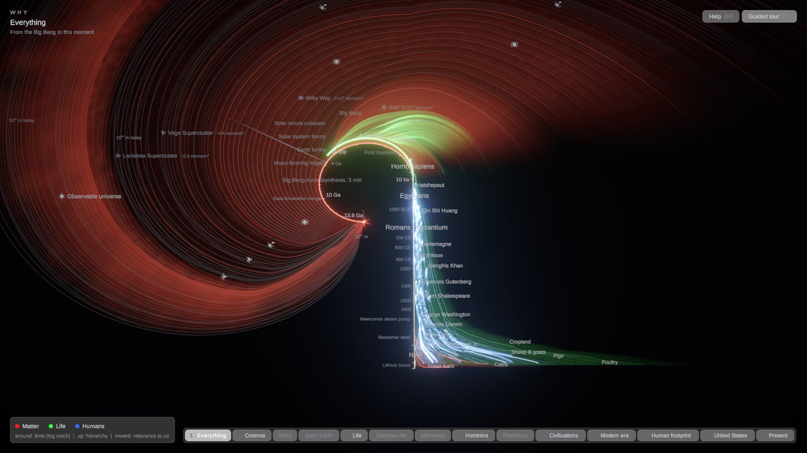

## Reading the graph

| | |
| --- | --- |
| **Path** | Time runs clockwise. From the Big Bang at 6 o'clock the path circles a super-logarithmic clock of deep time (`Ft(t) = t^(t^(-1.4 - 2.39t))`): stars and the Sun, Earth, life near 10 o'clock. At 3 o'clock, 5,000 years ago, it stops being a clock: human history leaves the circle on a straight branch with near-linear time, ending at the present moment. |
| **Color** | Used for one thing only - the three levels of the universe: **red** = all matter, **green** = all life, **blue** = humans. Everything else is neutral grey. |
| **Height** | The same hierarchy: matter at the bottom, life above it, humans on top. Human lifelines rise and fall with modeled social market value. |
| **Radius** | Relevance to us. The inner track is our own lineage (universe, Milky Way, Sun, Earth, first cells ... great apes, civilizations); everything that split off along the way drifts outward and fades. |
| **Glow** | Attention: our lineage, famous figures, and whatever the guide is pointing at. |

**Red - matter.** Our home at every scale, nested from the inside out: Earth, the Sun, the Milky Way, the
Local Group, the Virgo Supercluster and Laniakea, inside the observable universe. The red layer follows
the real expansion of space (a Lambda-CDM scale factor), so it billows out across the early clock, and
every nested body grows with it as a contour that splits off smoothly, never in steps. Each region is
shaded by its real density, so the gaps between the contours read as orders of magnitude - from 3x10^30
atoms/m^3 in Earth to 2x10^5 between the stars and ~0.3 between the galaxies - and every strand carries
an icon (sun, spiral galaxy, galaxy group, supercluster, cosmic web ...). The red layer is one continuous scale, so no two of its lines ever cross: a comb of comoving distances from our
lineage, one cell per order of magnitude, from the trunk (the inner track: a kilometre, the most granular scale) out to
the observable universe, twenty-three decades in all, like the rings of a logarithmic map of the universe. The comb's
spacing is the fan's width at each moment, so at the Big Bang every line lies on the trunk; as space inflates (a burst
at the cusp, then the cosmic scale factor) the comb opens: the outermost lines race outward fastest, every inner cell's
growth pushes everything beyond it further out, and each finer line separates from its parent only once their cell has
grown, so the scale branches open like a tree, decades first, then the 2..9 steps, tenths and hundredths as you close
in. The bodies' edges are lines in the same comb: a bound body keeps its physical size, so its edge and the grid inside
it drift gently inward through the comoving comb once it has formed, and before that its matter's region rides the
expansion, relaxing inward as the body collapses. Out on the envelope the lines dissolve into black. The probe (G) reads real numbers anywhere: metres from
us, metres per unit of the graph. Matter
dissolves before the human branch.

**Green - life.** The TimeTree of Life (1610 families) drawn as an expanding set of roots. Branches are
ordered by food chain with the top predator on the inside track, so the innermost root is the one that
leads to us: our direct ancestors glow, everything else stays dim, and the red layer recedes in the
life views. Life dissolves before the human branch; only our lineage rises into it (Homo sapiens,
300,000 years ago).

**Calories flow upward.** The food-chain order is also drawn as what it means: every level lives on the
calories of the level beneath it. In the life views, at three moments - the Devonian seas, the age of
dinosaurs and the Miocene grasslands - green arcs carry energy from producers to herbivores, predators and
top predators between their actual branches (green algae, crustaceans, cephalopods, sharks; cycads, leaf
beetles, amphibians, crocodilians; grasses, moths, swallows, falcons). Only roughly 10% of the energy passes
each step, so every arc is about ten times thinner and dimmer than the one before, and its pulses run from
prey to predator, inward toward our lineage.

**Beneath the humans - domination.** Directly under the civilizations lies the life people control -
livestock and crops, in green, on the same mass scale as humans (livestock now outweighs us) - and
beneath that the matter people extract - fuels, ores and minerals, in red. Every domestication is marked
where the species enters the farm layer; each material rises out of Earth's matter band.

**Blue - humans.** Civilization streams from the *Histomap* (Sparks 1931) whose widths are relative
power, continued to today with GDP shares. Inside each stream a gender-separated population curve holds
individual lifelines (women inside, men outside) that rise and fall with social market value; each line
stands for N people (shown on screen). The whole human layer starts as a thread and explodes outward with population. Famous figures glow,
threads show who influenced whom, and the people panel (F) lists who was alive at any moment. The United States 1950 - now is simulated
in detail from UN age pyramids with marriage, divorce, births and partner counts (the former `smv`
project); children's lines start from their parents. Today's most followed people (the social graph behind Unity-FDG)
live as faint white lifelines in their region's streams - the United States, East Asia (China and Japan), South Asia
(India), Europe, and a band for the rest of the world - and gather at the present in one white cloud per region, laid out
by who follows whom. Beneath every civilization hangs its state: a grey block as deep as the share of output its
government took (published data for modern states, calibrated Jev judgments before), in strata of social programs,
the military and the rest, with taxes falling into it, programs rising out of it, and its rulers, generals and
reformers marked along its top for their years in office.

## In pictures

| | |
| --- | --- |
| 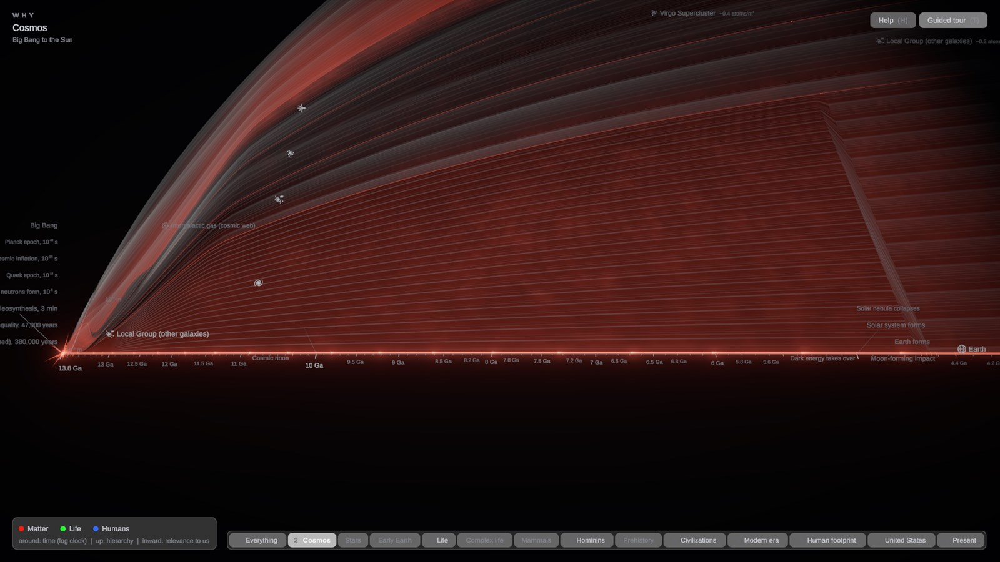 | 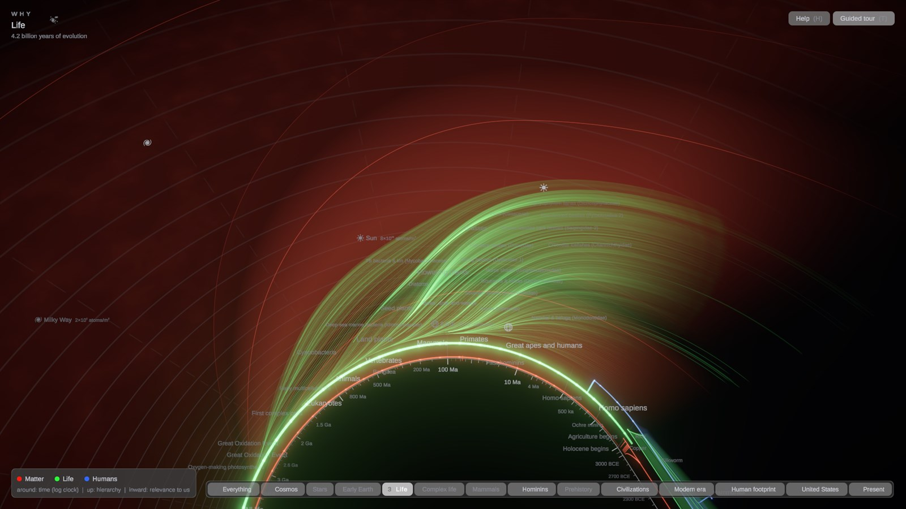 |
| **The cosmic fan.** Our home bodies expand with the universe, each strand marked with an icon and its density; beneath them the scale grid, one line per order of magnitude of distance from us. | **Life.** The roots of the tree of life, our direct ancestors glowing on the inside track. |
| 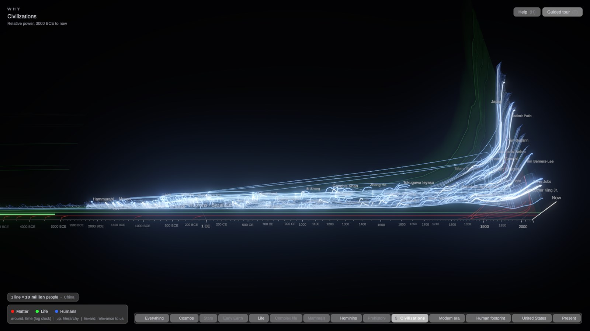 | 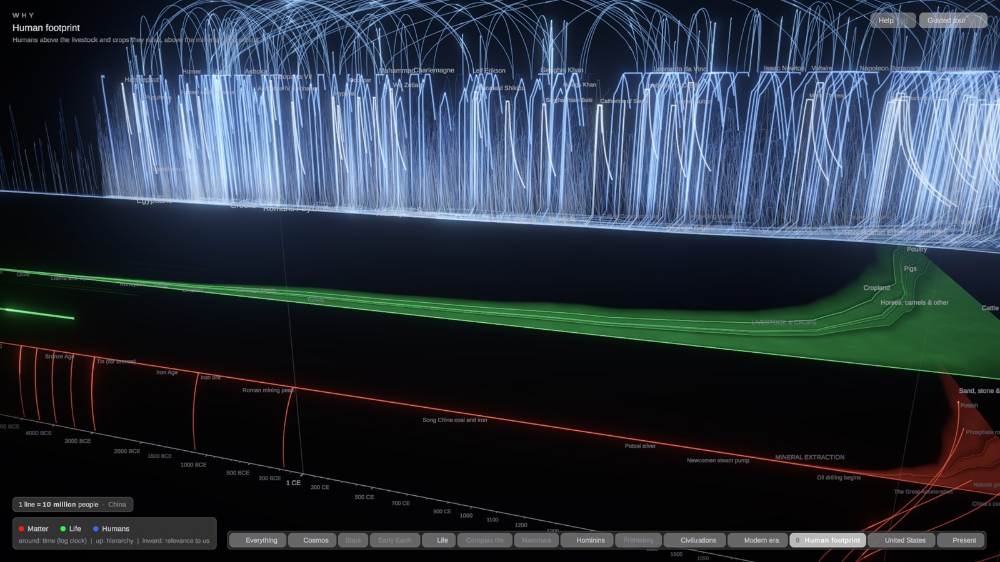 |
| **Civilizations.** Streams sized by relative power, starting as a thread and exploding with population; famous figures glow. | **Human footprint.** Humans on top, the livestock and crops they raise beneath, the minerals they mine beneath that. |
| 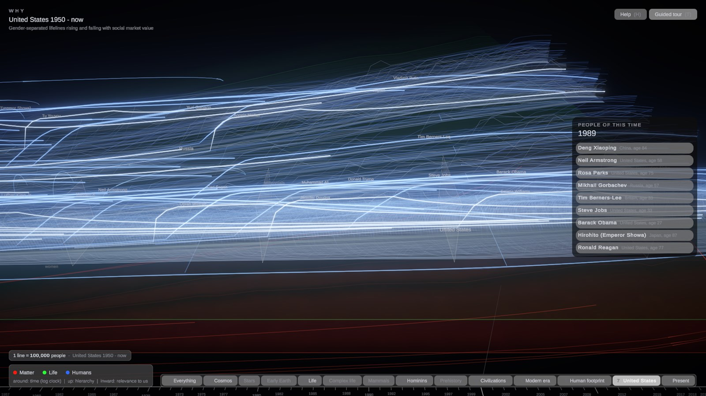 | 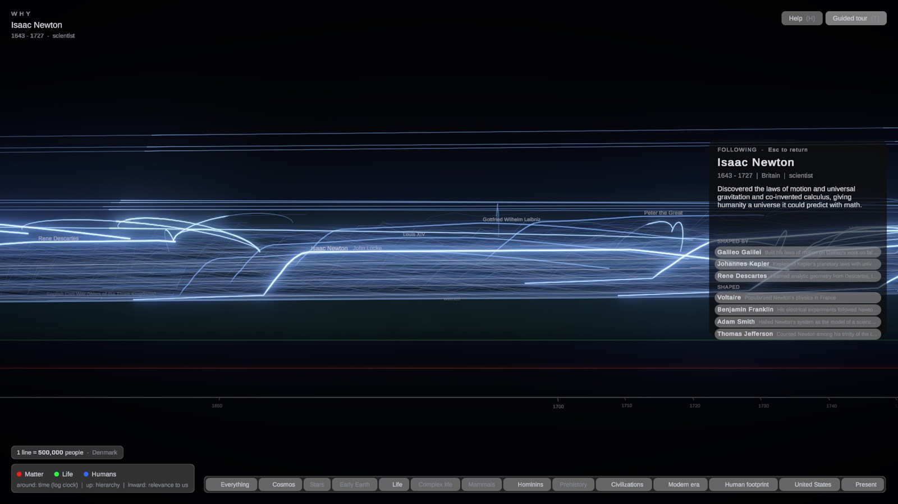 |
| **United States 1950 - now.** Gender-separated lifelines rising and falling with social market value, with the people of the moment. | **Following a figure.** Isaac Newton's life among his contemporaries, with who shaped him and whom he shaped. |
| 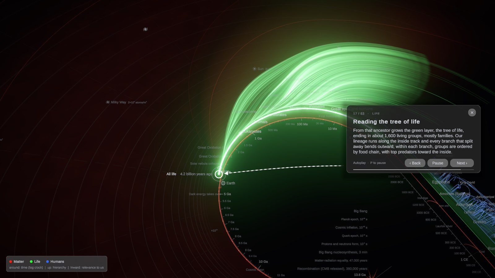 | 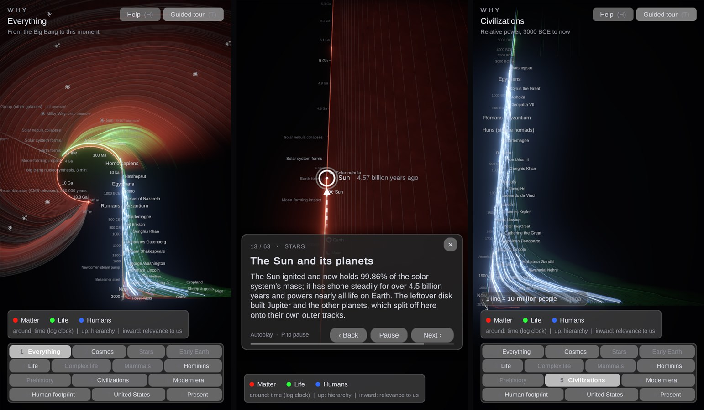 |
| **Guided tour.** 63 narrated stops with attention arrows, from the Big Bang to this moment. | **Vertical mode.** Every view, the tour and the HUD re-laid out for 9:16 phone videos. |
| 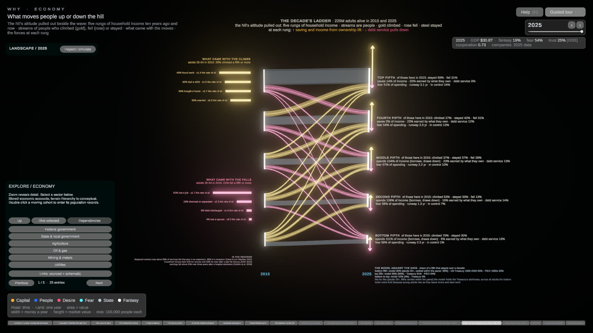 | 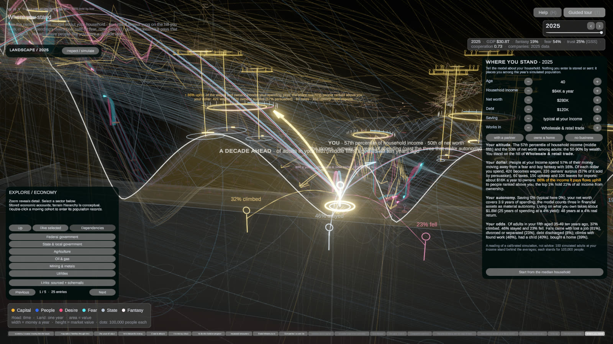 |
| **What moves people up or down.** The decade's ladder: five rungs of household income in 2015 and 2025, streams of people that climbed or fell, what came with the moves, the forces at each rung, and the model against the tax records. | **Where you stand.** Your household placed among the year's simulated Americans: your rung on your hill, where your money flows and which way, your runway, and the odds of people like you. |
| 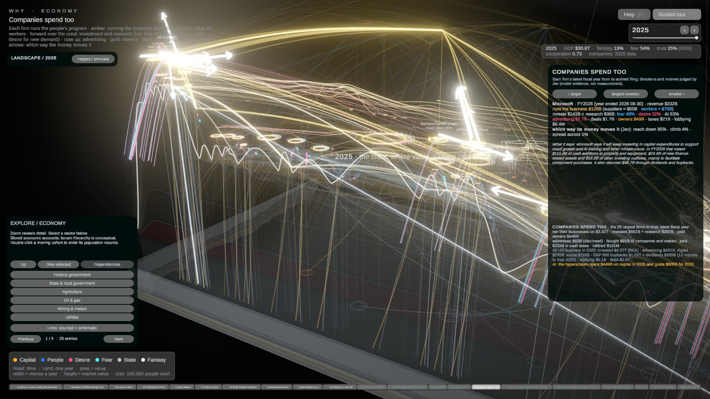 | 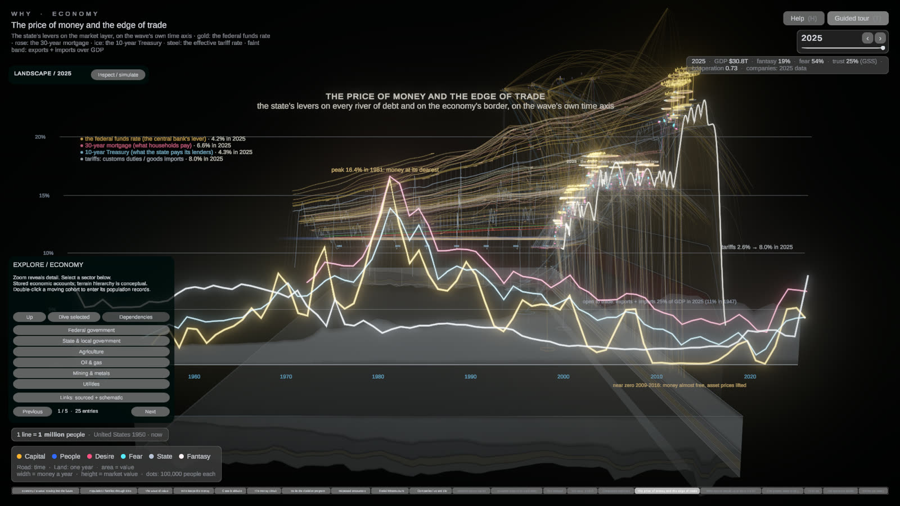 |
| **Companies spend too.** Each large firm's year of money from its filing, in the directions it flows, with Jev's arrows for which way it moves the firm; the AI build-out pouring down the hill. | **The price of money and the edge of trade.** The state's levers on the market layer: interest rates and the tariff rate on the wave's own time axis. |
| 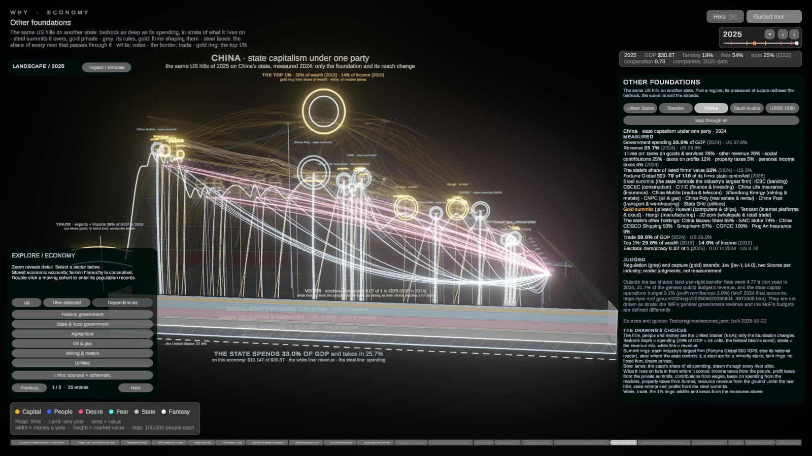 | 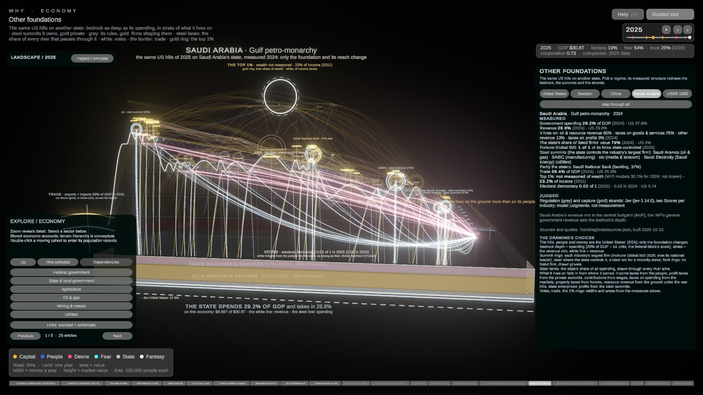 |
| **Other foundations: China.** The same US hills on China's state: a bedrock 33% of GDP deep, and steel summits where the state controls the industry's largest firm (banks, oil, the grid, telecom), gold where private firms lead (Huawei, Tencent, JD.com). | **Other foundations: Saudi Arabia.** A state that lives on oil (the amber stratum, 60% of its revenue) and controls the oil, chemicals, telecom and power summits; its vote threads nearly vanish (electoral democracy 0.02 of 1, V-Dem). |

## Controls

| Input | Action |
| --- | --- |
| Right drag | orbit |
| Middle drag / Shift + left drag | pan |
| Scroll | zoom toward the cursor |
| W A S D / Q E | move |
| 1 - 9 | views: everything, cosmos, life, hominins, civilizations, modern era, US population, the present, human footprint |
| U | unroll the timeline around what you are looking at (again to roll back up) |
| [ / ] | widen / narrow the unrolled time window |
| L | cycle log / mixed / linear time in the unrolled window |
| T | guided tour (director mode): Space / Right next, Left back, P pause, M mute the narration, Esc exit; it ends by continuing into the economy |
| Tab | switch between the universe and the economy |
| R | in the economy: replay the wave - the crest advances a year at a time from 1950 to the latest year with what changed in each (again to pause, Shift + R from the start; also the play button on the year chip) |
| F | people of this time: famous figures alive at the moment you are looking at; click one to follow their life |
| G | scale probe: point at the red layer to read the distance from us in metres, and how many metres (and years) one unit of the graph stands for there |
| V | vertical mode: a 9:16 layout for recording phone videos (again to go back) |
| H | help |
| Hover / click a label | details / focus and highlight it |

## Narration

The whole model has a spoken, guided walkthrough in John's own voice (an ElevenLabs clone, "JohnV4"), top to
bottom: it opens with why the graph exists - understand cause and effect and you can build a working model of the
universe from the Big Bang to this moment - walks the three levels across 64 stops, and at its end continues straight
into the economy scene for 20 more (the wave, its foundation, the price of money, other foundations, layers, companies
and what they spend, golden circles, attention, rivers of desire and fear, what moves people up or down, one person's mind,
tit for tat, the ladder, where you stand). About 38 minutes in all; the six newest economy stops (`hills_money`,
`hills_regimes`, `hills_strategy`, `hills_attention`, `hills_mobility`, `hills_you`) are written and checked but not yet
voiced, so they read their on-screen text until `python3 Tools/synthesize-narration-elevenlabs.py --only economy_narration`
is run.

* Scripts (tracked): `Assets/Resources/Data/Walkthrough/` - `tour.json` and `economy_tour.json` hold each stop's view,
  arrow target and on-screen text; `tour_narration.json` and `economy_narration.json` hold what is spoken. Each spoken
  stop was checked against its on-screen text with Jev (contradiction, unsupported claims, faithfulness).
* Voice: `python3 Tools/synthesize-narration-elevenlabs.py` writes `Assets/Resources/Audio/Tour/<id>.ogg` and
  `Audio/EconomyTour/<id>.ogg` (key from `$ELEVENLABS_API_KEY` or `~/Desktop/eleven-key.txt`, never printed; only
  stops whose text changed are re-voiced; ffmpeg converts to Ogg). The clips are generated, so they stay out of Git.
* A local `Data/tour.json` still overrides the walkthrough while drafting; a stop without a clip reads its on-screen
  text at the usual pace. The older OpenAI/Cartesia scripts (`Tools/generate-narration.ps1`,
  `Tools/synthesize-narration.ps1`) remain for reference.

## Meta Quest

Both scenes run on Meta Quest (OpenXR, Android, Vulkan, single-pass instanced). Desktop builds are unaffected: XR
starts only on Android.

* Build: `Tools/build-quest.sh` (add `--copy` while the Editor has the project open, `--install` to sideload over USB
  with developer mode on), or **Why > Quest > Build APK** in the Editor. Output: `Builds/Quest/why.apk`
  (`io.primitive.why`); on the headset it is under Library > Unknown Sources. **Why > Quest > Configure XR** (also run
  by every build) sets OpenXR with the Meta Quest feature, hand tracking (XR Hands 1.9) and Meta hand aim, and no
  controller profiles.
* In the headset every view is a diorama: the view's subject sits at arm's length and the world is scaled to it, so
  the Big Bang, a clade or one lifeline can each be walked around - and the world can be grabbed and resized at will.

Input is hands only (no controllers; the manifest requires hand tracking, so the headset never asks for them):

| Hands | Action |
| --- | --- |
| Point with the right hand, pinch | select (labels, people, companies, panel buttons) |
| Pinch with either hand and move | drag the world |
| Pinch with both hands | pull apart / together: grow / shrink the world; twist: turn it |
| Turn the left palm toward your face | the menu: the guided tour's transport (back, play / pause, next, leave), one icon per chapter of the tour (pinch to hear the narration from there; the chapter on screen is lit), the other scene, in the economy the replay of the wave (play / pause), recenter |

Both hands are drawn as glowing skeletons; the pointing ray is Meta's hand aim (from the shoulder through the hand).
Nothing to press floats in the room: the screen's buttons and panels are replaced by the hand menu; only what you read
(the tour's narration card, tooltips) stays in front of you. The narration keeps playing while you move the world.

The launch icon and the headset's splash are the graph itself (`Assets/Branding`, rendered by `Tools/make-branding.sh`
from a desktop player's `-iconshot` mode).
Panels float on a HUD plane that follows your gaze; the tour's target is marked by a beacon in the world instead of the
screen arrow. Line widths are still in pixels per eye, and frame rate on device has not been profiled yet.

## Vertical mode

For tutorial videos watched on a phone, the whole experience re-lays itself out whenever the window is
taller than it is wide: the HUD and tour text grow to phone size, the tour narration docks as a bottom
(or top) sheet clear of its arrow, and unrolled views turn so time runs down the screen. In the Editor,
press V in Play mode or use **Why > Game View > Portrait 1080x1920** (and **Landscape 1920x1080** to go
back); record with Unity Recorder or any screen recorder. In a built player, V opens a 9:16 window.

## The economy scene

Open `Assets/Scenes/Economy.unity` and press Play. The economy is a wave moving forward through time: the road of
United States lives (1946 to now) and the economy share one time axis, and at its end the population's cross-section
opens into a hillside of industries. Each rib behind the crest is one year's economy, widening as real output grows;
raw materials, manufacturing and infrastructure, services and tech stand on one another on a government bedrock, each
industry a ridge as wide as its share of value added. The crest is the shown year. 75 companies live on the ridges like
people on the road: born, rising and falling with their (approximate) market value, failing, bought or reaching the
crest, colored by how Jev judged each one sells (need, manufactured want or fear). People live on the slope of the
industry that pays them, class by altitude (those government pays stand on the valley floor in front of the hills); their
spending runs to each industry's market as rivers of desire and fear (split by the fear share of what is bought there),
saving leaves over the crest into the future and debt arrives from it. Every stored firm sits inside a gold inner circle
of elite owners. The old torus renderers remain in code but are disabled through `EconomyLayouts`.

Above the wave float the United States' most followed people, from the social graph (Instagram follows and its
force-directed layout, resolved to Wikidata and judged by Jev): white stars, brighter than the gold pool of wealth
beside them, in the graph's category clouds. A popular person who runs a listed company (Musk, Zuckerberg, Bezos, Gates,
Cook) stands on that company's gold inner circle instead; officeholders of the shown year sit on the government. The
government is a grey block beneath the whole wave: along time its depth is federal outlays as a share of GDP (OMB),
split into social programs, the military, interest and the rest, with receipts drawn inside it. Taxes come in from
households and from each industry's profits; regulation goes up into each hill and regulatory capture comes back down
(Jev); the year's president, legislators and reform movements sit on and in front of its crest edge. The keyless
`social` view frames the cloud; scrubbing the year rebuilds all of it for that year.

Keys 1–9 and 0: overview, population/families, the wave, ownership, class, rivers, the 3D mind, society, social
infrastructure and companies. Three keyless views follow one person (the inspected person, else the striver notable):
`atom` (the person on their hillside with a 3D mind of five desire and five fear drives above them, and the pulls of
those drives across the landscape), `dilemma` (a live tit-for-tat arena with spouse, coworker, neighbor, boss and the
other tribe, and the groups' cooperation above) and `ladder` (their life across the wave, rung by rung). Orbit and
zoom with the existing camera controls. Click a player for its historical inspector. The collapsed **Inspect / simulate**
control opens an independent scenario ledger: choose a player, adjust reason/fear, step or play years, and reset.
All players run the scenario program; assets, debt, consumption and support transfers are accounted for separately
from historical records. The same selected player's state appears in the 3D mind view. Comma/period and the year
scrubber still select historical years. T runs the wave tour.

**The wave replayed (R, or the play button on the year chip).** The crest advances a year at a time from 1950 (the first
year the land opens; the ribs of 1947-49 already lie in its wake) to the latest year, so cause and effect plays out on the
wave: each year's land is built on a worker while the year before is on screen, and the crest moves on only once the
year is shown - about a second a year, quicker through quiet years, longer at a turning point. A caption at the bottom of
the screen says what changed: GDP and its real growth, the market's real value added (the wave's width; a fall narrows
the wave), the tiers' shares of the market, the federal funds and tariff rates, federal outlays and receipts, the stored
companies born and ended, and in the mobility view the decade's ladder. Turning points are read off the data, not
authored - the four deepest falls of the market's real value added (1958, 1982, 2008-09, 2020), the four largest
swings of the federal funds rate (its peaks in 1974 and 1981, its troughs in 1983 and 1993) and the largest move of the
tariff rate (2024-26) - and are ticked on the year chip's scrubber (hover one to read it); once the crest has passed one,
its year's rib in the wake is traced faintly in its colour, with a pin and its tag above the rib. Every view keeps working:
views framed on the crest (landscape, capture, people, rivers, foundation, social, strategy, mobility) follow it, while
the overview, the companies and the money chart frame the whole time axis and the wave grows across them. Moving the year
yourself pauses the replay; the guided tour stops it.

Six more keyless views ask how the economy moves the people and the companies on it, and what it stands on (the preset
bar and the tour reach them; focused views keep the wave as faint ground and quiet everything else):

* `mobility` - **what moves people up or down the hill**: the hill's altitude pulled out beside the wave as the decade's
  ladder, five rungs of household income ten years ago and now, joined by streams of people that climbed (gold), fell
  (rose) or stayed; what came with the climbs and falls of prime-age adults (found work, married, a child, a home; a lost
  job, a divorce, debt discharged), each with its lift over everyone's rate; the forces at each rung (saving, income from
  ownership, debt service, fear, runway, in control); and the model against the published decade matrices (like for like
  - adults 25+, fifths ranked within the panel - the bottom fifth stays 56% and the top 66%, against the US Treasury's
  55% and 61% for 1996-2005). The people view gives every cohort an arrow from where its members stood ten years before.
* `you` - **where you stand**: steppers (no keyboard, so they work with hands in the headset) for age, household
  income, net worth, debt, saving, industry, partner, home and business; the model places you among the year's
  simulated adults (income and wealth percentiles) on your rung of your hill, draws your spending's rivers split by fear,
  which way the income it pays flows (uphill to people ranked above you, or down), a runway gauge toward autonomy, the
  years to living on what you own, and three possible futures in front of the crest, each as bright as the share of
  people like you who went there in the last decade. Nothing entered is stored or sent.
* `strategy` - **companies spend too**: every stored firm's latest fiscal year from its audited filing
  (`Tools/corporate`), in the directions its money flows: operations down to suppliers and workers (by its industry's
  accounts), investment and research forward over the crest split into fear and desire lanes, advertising up to the
  attention platforms, deals across, buybacks and dividends up to the owners, taxes and lobbying into the state; white
  arrows for which way Jev judged the money moves each firm (climb into AI, reach down into its own supply, spread across,
  lean on the state, harvest); the hyperscalers' AI build-out ($449B in 2025, guided $805B for 2026) pouring down into
  computers and data centers; a panel steps through the firms with the US totals beside them. Behind the crest each
  firm's trail runs along its lifeline through its fiscal years 2015-2025 (XBRL data of its 10-Ks on SEC EDGAR, each year
  judged by Jev on its numbers alone): a lane split into fear and desire for the year's investment and research, a gold
  stalk for its owners, the turns of direction named, so the AI race and the cycle can be read (the 23 firms with both
  ends invested and researched $205B in 2015 and $920B in 2025).
* `money` - **the price of money and the edge of trade**: the federal funds, 30-year mortgage and 10-year Treasury rates
  and the effective tariff rate (customs duties over goods imports) on the wave's own time axis, with trade's share of GDP.
* `regimes` - **other foundations**: the same hills on another state, as a model change - the United States, Sweden,
  China, Saudi Arabia and the Soviet Union around 1980, picked with buttons in a panel (or stepped through). The bedrock is
  as deep as the regime's government spending (IMF), in strata of what it lives on (OECD tax structures, the budgets' own
  categories); a summit turns from gold to steel where the state controls the industry's largest firm (the Fortune Global
  500 2026 and its government-ownership flag, or national leaders for Sweden and Saudi Arabia; the state's share of listed
  firms' value from the OECD); grey and gold strands for its rules and the industries
  shaping them (Jev); a steel lane of every river through the state; votes (V-Dem), trade (World Bank) and the top 1%'s
  shares (WID, latest observed years). The panel says what is measured, what is judged and what the drawing chooses.
* `social` now also rings every star by how many of the other most-followed accounts follow it (influence among the
  influential, from the graph's directed follows: Obama 70, Snoop Dogg 69, Rihanna 67) and draws the attention loop:
  companies pay the platforms ($295B of US digital ads in 2025), platforms and brands pay creators (about $37B), people give
  about two hours a day and take in wants, and spend.

The economy-only population geometry joins recorded parents at the mid-plane at birth and draws marriage links.
The original causality scene's population geometry is unchanged. Psychological weights, terrain elevation, synthetic
portfolios and allowance amounts are model assumptions. Stored macroeconomic data retain their existing vintage;
the September 30, 2026 BEA revision has not been incorporated, and 2026 estimates are labeled. This is an exploratory
model, not a calibrated forecast. See `Docs/hills-design/IMPLEMENTATION.md` for scope, validation and sources.

The narrated economy tour is part of the walkthrough (see Narration); generated audio stays out of Git.

## Project

Unity 6000.6.5f1, URP 17.6, OpenXR 1.18. Open `Assets/Scenes/Why.unity` (or `Assets/Scenes/Economy.unity`) and press Play; everything is built at
runtime in about two seconds (the original took about 30 s).

* `Docs/ARCHITECTURE.md` - the rendering core: data space, the GPU warp (clock + branch + lens),
  line/surface shaders, highlight ids, anchors, layers and modules.
* `Docs/DATA.md` - every data file, its schema and its sources.
* `Tools/compile-check.py` (`.ps1` on Windows) - compiles the scripts against Unity's assemblies outside the Editor.
* `Tools/jev.py` - calls Jev for typed judgments (key from the environment or `~/Desktop/jev-key.txt`).

## Sources

https://people.cs.umass.edu/~immerman/stanford/universe.html
https://en.wikipedia.org/wiki/Observable_universe#/media/File:Home_in_Relation_to_Everything-Observable_Universe.png
https://en.wikipedia.org/wiki/Chronology_of_the_universe
https://en.wikipedia.org/wiki/Geologic_time_scale

Phylogenetic Timetree:
http://www.timetree.org/book

Human History:
https://www.thehistomap.com/about

Population data:
https://ourworldindata.org/population-growth-over-time
https://econosystemics.com/?p=9
https://population.un.org/wpp/Download/Standard/Population/
https://www.census.gov/data/tables/time-series/demo/fertility/his-cps.html

Life expectancy:
https://ourworldindata.org/life-expectancy-how-is-it-calculated-and-how-should-it-be-interpreted
https://ourworldindata.org/why-do-women-live-longer-than-men

Sex partners:
https://bedbible.com/average-number-of-sexual-partners-promiscuity-statistics/
https://www.cdc.gov/nchs/nsfg/key_statistics/n-keystat.htm
